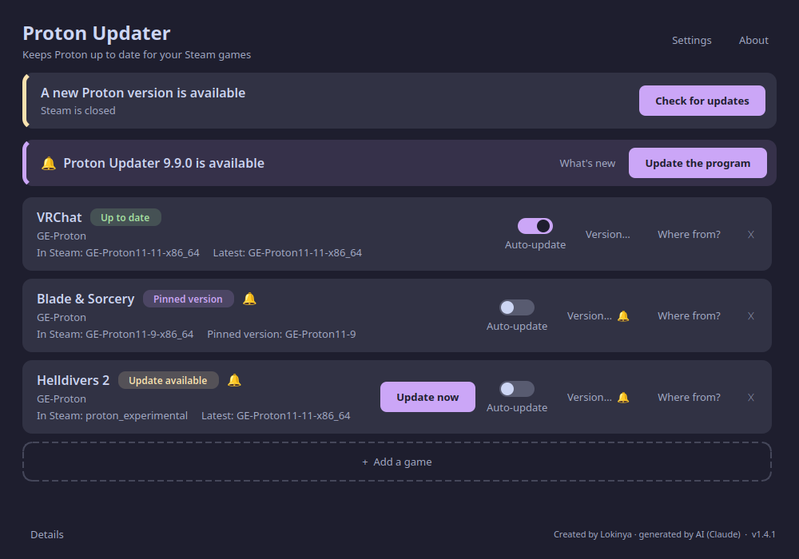

# Proton Updater

**English** · [Українська](README.uk.md)

> ## ⚠️ Created with artificial intelligence
> All code and this description were **generated by AI — Claude (Anthropic)** — at the request of the repository owner, **Lokinya**, during a conversation. The human set the requirements, tested the result on their own computer and decided what to keep.
> The program is small and open — read the code before you use it (~1000 lines of Python). No warranty.

A small Linux tool that **watches for new GE-Proton (and proton-rtsp) releases, installs them, and switches the Steam games you choose** to the new version. Made because VRChat on Linux wants a fresh Proton, and changing it by hand after every release gets old.



**Documentation:** [User guide with screenshots, FAQ and troubleshooting](docs/GUIDE.md) · [Security & privacy](SECURITY.md) · [Changelog](CHANGELOG.md)

## Install in one step

Paste this into a terminal (it downloads and installs everything, no root needed):

```bash
curl -fsSL https://raw.githubusercontent.com/lokinyauv-create/proton-updater/main/get.sh | bash
```

Then open **Proton Updater** from your application menu. You can also download [`get.sh`](https://github.com/lokinyauv-create/proton-updater/releases/latest) from the Releases page and run it. To remove: `~/.local/share/proton-updater/uninstall.sh`.

## Features

- **Auto-update switch** per game and a master switch in Settings; with it off you only get a 🔔 and an *Update now* button.
- Checks for new releases every 12 hours (a systemd timer wakes it every 30 min).
- Downloads **only from the authors' official GitHub releases** and **verifies sha512**. On a mismatch it installs nothing.
- Installs into `~/.local/share/Steam/compatibilitytools.d/`.
- Switches the Proton of the games you pick in Steam (`config.vdf` → `CompatToolMapping`).
- Add **any Steam game**; choose and **pin any older version**.
- **“Where is this from?”** — shows the author, repository, release page, download URL and checksum.
- **“Restart Steam”** — closes Steam, applies the switch, starts Steam again.
- Cleans up old versions (keeps the 2 newest per source and any in use).
- **Languages:** English and Ukrainian. Picked automatically from the system language; can be changed in **Settings**.

## Sources

| Key | What | Author / repository |
|---|---|---|
| `ge` | GE-Proton | [GloriousEggroll/proton-ge-custom](https://github.com/GloriousEggroll/proton-ge-custom) |
| `rtsp` | Proton-GE RTSP (video fixes for VRChat) | [SpookySkeletons/proton-ge-rtsp](https://github.com/SpookySkeletons/proton-ge-rtsp) |

These are other people's projects; this tool only downloads their releases.

### Custom sources

Need another Proton for another game? Open **Settings → Custom sources**, type a GitHub repository as `owner/repository` (for example the repo of Proton-CachyOS or Proton-EM) and add it. It then appears in the list when you add a game. The tool picks the Linux x86_64 archive (`.tar.gz`, `.tar.xz`, `.tar.zst` — the last one needs Python 3.14+) from each release, checks its sha256/sha512 file if the author published one, and reads the tool name from `compatibilitytool.vdf` inside the archive. Archives without that file are rejected.

## How it works

1. `proton-updater run` is started by the timer. It first applies any pending switch, then (if 12 h have passed) asks the GitHub API for each source's releases.
2. For each watched game it picks the wanted version (pinned or newest), downloads the archive, checks sha512 and unpacks it into `compatibilitytools.d`.
3. Steam rewrites `config.vdf` when it exits, so **the file may only be changed while Steam is closed**. If Steam is running, the switch is postponed and a notification is shown; once Steam is closed the timer applies it. A backup `config.vdf.bak-protonupd` is made before each write.
4. Settings: `~/.config/proton-updater/config.json`.

The window uses PySide6; the core (`protonupd.py`) also works without it: `proton-updater status | check | run | restart | install SOURCE VERSION | set APPID SOURCE [VERSION]`.

## Install from source

Requires: Linux, native Steam (`~/.local/share/Steam`), Python 3.11+, PySide6 (installed automatically), `notify-send` (notifications), systemd user session.

```bash
git clone https://github.com/lokinyauv-create/proton-updater
cd proton-updater
./install.sh
```

It copies the app to `~/.local/share/proton-updater`, creates the commands `proton-updater` and `proton-updater-gui`, a menu entry and `proton-updater.timer`. By default it watches VRChat (`438100`). Uninstall with `./uninstall.sh` (Proton versions and Steam settings stay).

## Tests

```bash
python3 -m unittest discover -s tests -v
```
39 tests run the whole flow (new release → download → checksum → switch) against a fake GitHub and a temporary fake Steam folder; nothing touches your real Steam.

## Limitations (honestly)

- Tested on Fedora 44 + KDE Plasma (Wayland) + native Steam. Flatpak Steam is not supported.
- The version-switching logic was tested on a copy of `config.vdf`; the real automatic switch is still waiting for its first new release.
- Edits `config.vdf` by text substitution, not with a full VDF parser.
- Does not work around the GitHub API rate limit without a token (enough for two sources every 12 h).

## License

[MIT](LICENSE) © 2026 **Lokinya**. If you use or modify this program, you must keep the copyright notice with the author's name.
