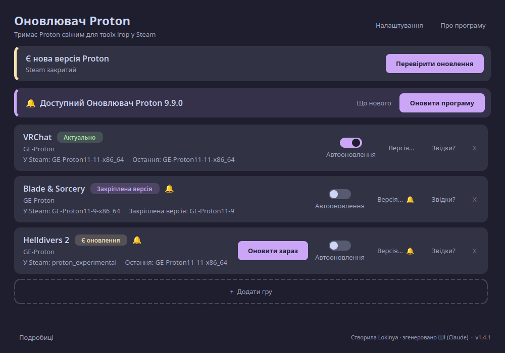

# Оновлювач Proton

[English](README.md) · **Українська**

> ## ⚠️ Створено штучним інтелектом
> Увесь код і цей опис **згенеровані штучним інтелектом — Claude (Anthropic)** — на прохання власниці репозиторію, **Lokinya**, під час діалогу. Людина ставила завдання, перевіряла результат на власному комп'ютері й вирішувала, що залишити.
> Програма маленька й відкрита — прочитай код перед використанням (~1000 рядків Python). Без гарантій.

Маленька програма для Linux, яка **сама стежить за новими версіями GE-Proton (і proton-rtsp), ставить їх і перемикає на нову версію вибрані тобою ігри в Steam**. Зроблена, бо VRChat на Linux вимагає свіжого Proton, а міняти його вручну після кожного релізу набридає.



**Документація:** [Посібник зі знімками, питання й відповіді, якщо щось не так](docs/GUIDE.uk.md) · [Безпека й приватність](SECURITY.md) · [Список змін](CHANGELOG.md)

## Встановлення в один крок

Встав це в термінал (воно саме завантажить і встановить усе, права адміністратора не потрібні):

```bash
curl -fsSL https://raw.githubusercontent.com/lokinyauv-create/proton-updater/main/get.sh | bash
```

Потім відкрий **«Оновлювач Proton»** у меню програм. Також можна завантажити [`get.sh`](https://github.com/lokinyauv-create/proton-updater/releases/latest) зі сторінки Releases і запустити. Видалити: `~/.local/share/proton-updater/uninstall.sh`.

## Що вона вміє

- **Перемикач автооновлення** для кожної гри й загальний у налаштуваннях; коли вимкнено — лише 🔔 і кнопка «Оновити зараз».
- Раз на 12 годин перевіряє нові релізи (таймер systemd будить її кожні 30 хв).
- Качає **лише з офіційних GitHub-релізів авторів** і **перевіряє sha512**. Якщо сума не збігається — не ставить.
- Ставить у `~/.local/share/Steam/compatibilitytools.d/`.
- Перемикає Proton вибраних ігор у Steam (`config.vdf` → `CompatToolMapping`).
- Можна додати **будь-яку гру** зі Steam і вибрати та **закріпити будь-яку попередню версію**.
- **«Звідки це?»** — показує автора, репозиторій, сторінку релізу, адресу завантаження й контрольну суму.
- **«Перезапустити Steam»** — закриває Steam, застосовує зміну, запускає знову.
- Прибирає старі версії (лишає 2 найновіші кожного джерела й ті, що використовуються).
- **Мови:** англійська та українська. Обирається автоматично за мовою системи; змінити можна в **Налаштуваннях**.

## Джерела

| Ключ | Що | Автор / репозиторій |
|---|---|---|
| `ge` | GE-Proton | [GloriousEggroll/proton-ge-custom](https://github.com/GloriousEggroll/proton-ge-custom) |
| `rtsp` | Proton-GE RTSP (виправлення відео для VRChat) | [SpookySkeletons/proton-ge-rtsp](https://github.com/SpookySkeletons/proton-ge-rtsp) |

Це проєкти інших авторів; ця програма лише завантажує їхні релізи.

### Свої джерела

Потрібен інший Proton для іншої гри? Відкрий **Налаштування → Свої джерела**, впиши репозиторій GitHub у форматі `власник/репозиторій` (наприклад, репозиторій Proton-CachyOS чи Proton-EM) і додай. Воно з'явиться у списку, коли додаєш гру. Програма бере з кожного релізу архів для Linux x86_64 (`.tar.gz`, `.tar.xz`, `.tar.zst` — останній потребує Python 3.14+), перевіряє файл sha256/sha512, якщо автор його опублікував, і читає назву інструмента з `compatibilitytool.vdf` в архіві. Архіви без цього файлу відхиляються.

## Як це працює

1. `proton-updater run` запускається таймером. Спершу застосовує відкладені перемикання, потім (якщо минуло 12 год) питає GitHub API про релізи кожного джерела.
2. Для кожної гри зі списку обирає потрібну версію (закріплену або найновішу), качає архів, звіряє sha512, розпаковує в `compatibilitytools.d`.
3. Steam перезаписує `config.vdf` при виході, тому **змінювати файл можна лише коли Steam закритий**. Якщо Steam працює — зміна відкладається, програма показує сповіщення; щойно Steam закрито, таймер застосує перемикання. Перед записом робиться копія `config.vdf.bak-protonupd`.
4. Налаштування: `~/.config/proton-updater/config.json`.

Вікно — на PySide6; ядро (`protonupd.py`) працює і без нього: `proton-updater status | check | run | restart | install ДЖЕРЕЛО ВЕРСІЯ | set APPID ДЖЕРЕЛО [ВЕРСІЯ]`.

## Встановлення з коду

Потрібні: Linux, нативний Steam (`~/.local/share/Steam`), Python 3.11+, PySide6 (ставиться сам), `notify-send` (сповіщення), користувацький systemd.

```bash
git clone https://github.com/lokinyauv-create/proton-updater
cd proton-updater
./install.sh
```

Копіює програму в `~/.local/share/proton-updater`, створює команди `proton-updater` і `proton-updater-gui`, ярлик у меню та таймер `proton-updater.timer`. За замовчуванням стежить за VRChat (`438100`). Видалення: `./uninstall.sh` (версії Proton і налаштування Steam лишаються).

## Тести

```bash
python3 -m unittest discover -s tests -v
```
39 тестів проганяють увесь потік (новий реліз → завантаження → контрольна сума → перемикання) на підставному GitHub і тимчасовій підставній теці Steam; справжнього Steam це не чіпає.

## Обмеження (чесно)

- Перевірено на Fedora 44 + KDE Plasma (Wayland) + нативний Steam. Flatpak-Steam не підтримується.
- Логіку перемикання версії в `config.vdf` перевірено на копії файлу; реальне автоперемикання ще чекає першого нового релізу.
- Змінює `config.vdf` текстовою заміною, без повного парсера VDF.
- Не обходить ліміт запитів GitHub API без токена (для двох джерел раз на 12 год цього досить).

## Ліцензія

[MIT](LICENSE) © 2026 **Lokinya**. Якщо використовуєш або змінюєш цю програму, мусиш залишити повідомлення про авторське право з іменем авторки.
