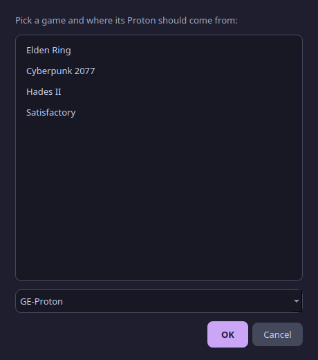
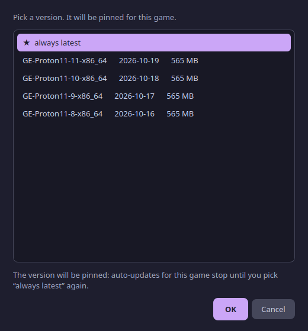
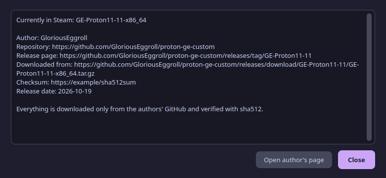
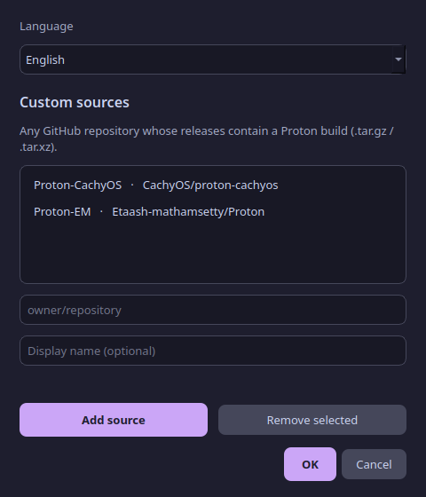
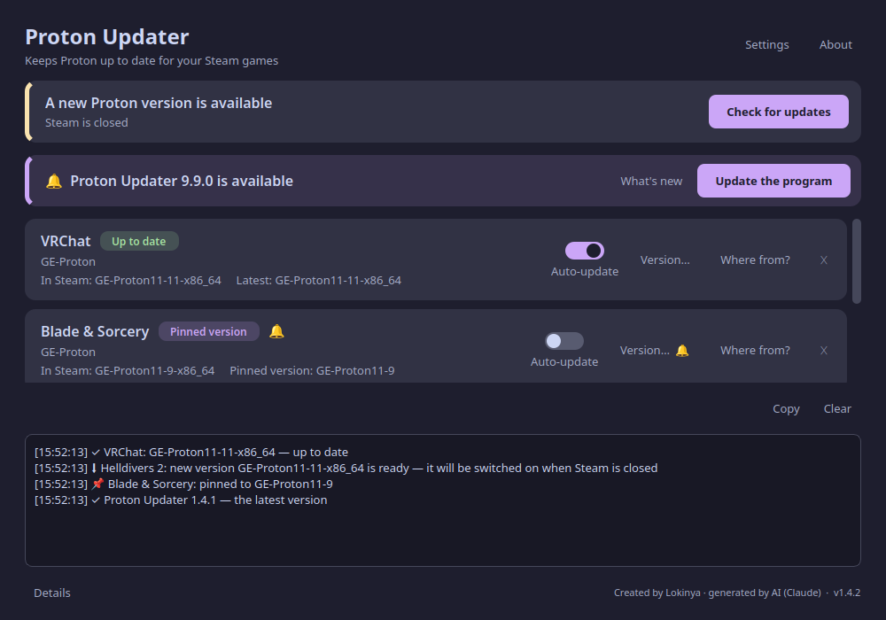

# Proton Updater — user guide

**English** · [Українська](GUIDE.uk.md) · [← README](../README.md)

> Created by Lokinya. Generated by AI (Claude, Anthropic).

## What is this for?

Steam runs Windows games on Linux through a layer called **Proton**. Some games (VRChat is the classic example) need a newer or special Proton than the one Steam ships — for example **GE-Proton**. New GE-Proton versions come out every few days, and switching each game by hand is tedious. This program does it for you.


## Quick start

1. **Install** (one line in a terminal): see the [README](../README.md#install-in-one-step).
2. Open **Proton Updater** from the application menu. VRChat is already on the list.
3. Click **Check for updates**. If a newer version exists, it is downloaded, verified and prepared.
4. The game switches to it **when Steam is closed** (or press **Restart Steam & apply**). From now on this happens automatically.

That's all. You can close the window — a background timer keeps watching.

## Auto-update on / off

Every game card has an **Auto-update** switch.

| Switch | What happens |
|---|---|
| **On** (purple) | New Proton versions are downloaded and the game is switched by itself. |
| **Off** (grey) | The game stays on its current version. You still get a 🔔 and a notification when a newer version is out, and an **Update now** button appears on the card. |

Choosing a specific version with **Version…** also turns the switch off (the version is pinned); switching it **on** again returns the game to “always latest” and catches up right away.

**Settings → Automatic background updates** is the master switch for everything. When it is off, nothing is downloaded or switched in the background — you only get notifications and update with the buttons (**Check for updates** and **Update now** still work).

```bash
proton-updater auto off            # master switch off
proton-updater auto on 438100      # switch on for one game (VRChat)
```

## The bell 🔔

A bell means **a newer Proton has been released than the one this game uses**. It appears next to the game's status and on the **Version…** button; hover it to see which version. You also get a desktop notification (once per release) — for pinned games too, so you know the moment a newer version is out while the game stays on its pinned one.

At the top of the window a purple strip **🔔 Proton Updater X.Y.Z is available** means a new version *of this program* exists. Press **Update the program**: it downloads the release from GitHub, installs it and restarts itself. **What's new** opens the release notes. The background timer also sends a desktop notification (once per version).

```bash
proton-updater version      # shows your version and whether a newer one exists
proton-updater selfupdate   # update the program from the terminal
```

## What the card colours mean

| Chip | Meaning |
|---|---|
| 🟢 **Up to date** | The game already uses the newest version. |
| 🟡 **Update available** | A newer version exists; it will be installed on the next check. |
| 🔵 **Waiting for Steam** | The new version is installed and will be applied as soon as Steam is closed. |
| 🟣 **Pinned version** | You chose a specific version; automatic updates for this game are off. |

## How to…

### Add another game
Click **+ Add a game**, pick the game, pick where its Proton should come from, press OK.



### Use an older (or any specific) version
Click **Version…** on the game's card, choose a version and press OK. It is downloaded, applied and **pinned**: this game stops auto-updating. Choose **★ always latest** in the same list to go back to automatic updates.



### See where a version really comes from
Click **Where from?** — you'll see the author, the repository, the release page, the exact download link and the checksum file. The button *Open author's page* opens the release in your browser so you can compare.



### Add a different Proton (another author)
**Settings → Custom sources**, type a GitHub repository as `owner/repository`, press **Add source**. It will then be offered when you add a game.



### Change the language
**Settings → Language**: *Automatic* follows your system, or pick English / Українська.

### Apply an update right now
Press **Restart Steam & apply** (it appears when an update is waiting). Steam closes and starts again. If a game is running you'll be asked to quit it first.

### Read what happened (Details)
Click **Details** (bottom left). Every check writes one line per game — which version it uses, whether it is up to date, and whether a new one is ready — plus whether the program itself is the latest. Lines carry a time stamp. **Copy** puts the log on the clipboard (handy for a bug report), **Clear** empties it.



### Use it without the window
```bash
proton-updater status     # what is installed / pending
proton-updater check      # check and install now
proton-updater restart    # restart Steam and apply
```

## FAQ

**Is it safe?** It downloads only from GitHub release pages of the authors you listed, verifies the sha256/sha512 file when the author publishes one, and edits only Steam's tool mapping (a backup is made first). See [SECURITY.md](../SECURITY.md).

**Why doesn't a game switch immediately?** Steam rewrites its settings file when it exits, so the file may only be changed while Steam is closed. Close Steam (or use *Restart Steam & apply*).

**Will it break my game?** A new Proton version occasionally behaves worse for some game. Pin the previous version with **Version…** and the game goes back; old versions are kept for a while (the 2 newest per source and any in use).

**Does it touch Valve's own Proton (Proton 11, Experimental)?** No — Steam updates those itself.

**Does it work with Flatpak Steam?** Not yet. It expects the native Steam in `~/.local/share/Steam`.

**How often does it check?** Every 12 hours (a systemd timer wakes it every 30 minutes to apply anything pending). *Check for updates* checks right now.

**Does it need a GitHub account?** No. Without one GitHub allows 60 requests per hour; answers are cached, so normal use never gets close. If you hit the limit you'll be told when it resets (or set a `GITHUB_TOKEN` environment variable).

**Where are my settings?** `~/.config/proton-updater/config.json`. Downloaded Proton versions live in `~/.local/share/Steam/compatibilitytools.d/`.

## Troubleshooting

| Problem | What to do |
|---|---|
| “GitHub request limit reached” | Wait until the time shown, or set `GITHUB_TOKEN`. |
| Game still on the old version | Close Steam completely (tray icon too) and wait up to 30 min, or press *Restart Steam & apply*. |
| “Checksum mismatch — not installing” | The download was corrupted or altered. Nothing was installed; try again later. |
| Custom source: “No Linux Proton archives found” | That repository's releases have no `.tar.gz/.tar.xz/.tar.zst` Proton archive. |
| Custom source: “not a Steam compatibility tool” | The archive has no `compatibilitytool.vdf` inside. |
| The new version doesn't appear in Steam's own list | Restart Steam once; Steam reads that folder at start. |
| Something else | Click **Details** (bottom left of the window) for the log, and open an [issue](https://github.com/lokinyauv-create/proton-updater/issues). |

## Uninstall

```bash
~/.local/share/proton-updater/uninstall.sh
```
Installed Proton versions and Steam's settings stay as they are.
