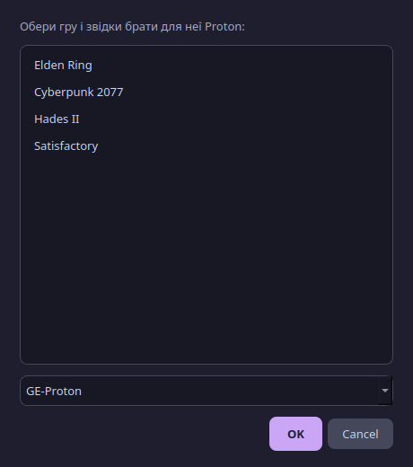
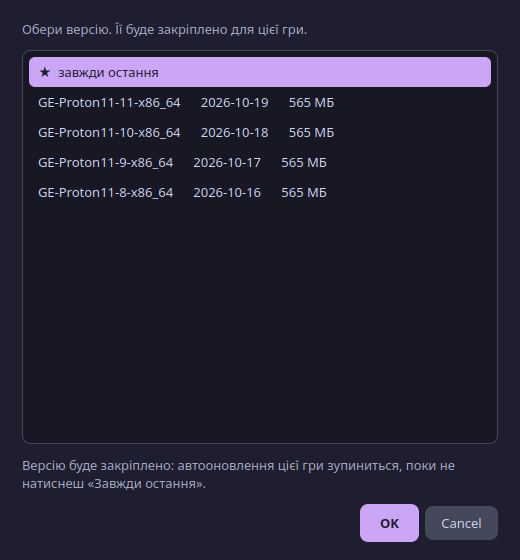
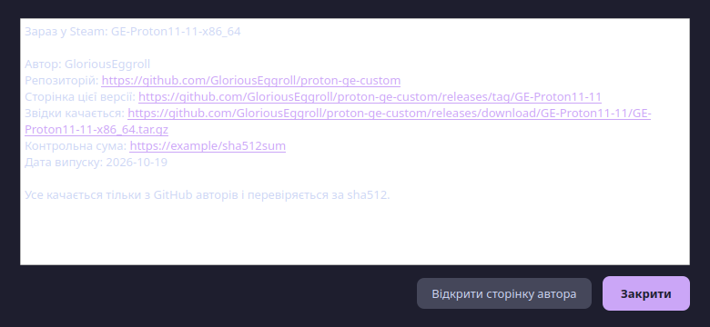
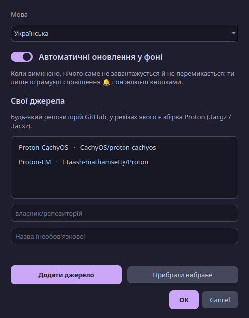

# Оновлювач Proton — посібник користувача

[English](GUIDE.md) · **Українська** · [← README](../README.uk.md)

> Створила Lokinya. Згенеровано штучним інтелектом (Claude, Anthropic).

## Для чого це?

Steam запускає Windows-ігри на Linux через шар під назвою **Proton**. Деяким іграм (класичний приклад — VRChat) потрібен новіший або особливий Proton, а не той, що йде зі Steam, наприклад **GE-Proton**. Нові версії GE-Proton виходять раз на кілька днів, і перемикати кожну гру вручну втомлює. Ця програма робить це за тебе.


## Швидкий старт

1. **Встанови** (один рядок у терміналі): дивись [README](../README.uk.md#встановлення-в-один-крок).
2. Відкрий **«Оновлювач Proton»** у меню програм. VRChat уже в списку.
3. Натисни **«Перевірити оновлення»**. Якщо є новіша версія, її буде завантажено, перевірено й підготовлено.
4. Гра перемкнеться на неї, **коли Steam закритий** (або натисни **«Перезапустити Steam і застосувати»**). Далі це відбувається саме.

Це все. Вікно можна закрити: таймер у фоні продовжує стежити.

## Автооновлення вкл / викл

На кожній картці гри є перемикач **«Автооновлення»**.

| Перемикач | Що відбувається |
|---|---|
| **Увімкнено** (фіолетовий) | Нові версії Proton завантажуються, а гра перемикається сама. |
| **Вимкнено** (сірий) | Гра лишається на поточній версії. Ти все одно отримуєш 🔔 і сповіщення, коли вийшла новіша, а на картці з'являється кнопка **«Оновити зараз»**. |

Якщо обрати конкретну версію через **«Версія…»**, перемикач теж вимикається (версію закріплено); якщо знову **увімкнути**, гра повертається до «завжди остання» й одразу наздоганяє.

**Налаштування → Автоматичні оновлення у фоні** — загальний вимикач. Коли він вимкнений, у фоні нічого не завантажується й не перемикається: ти лише отримуєш сповіщення й оновлюєш кнопками (**«Перевірити оновлення»** та **«Оновити зараз»** працюють).

```bash
proton-updater auto off            # загальний вимикач — вимкнути
proton-updater auto on 438100      # увімкнути для однієї гри (VRChat)
```

## Дзвіночок 🔔

Дзвіночок означає, що **вийшов новіший Proton, ніж той, яким користується ця гра**. Він з'являється біля статусу гри та на кнопці **«Версія…»**; наведи курсор, щоб побачити, яка саме версія. Також приходить сповіщення на робочий стіл (один раз на реліз) — і для закріплених ігор теж, тож ти знаєш, коли вийшла новіша версія, хоч гра й лишається на закріпленій.

Угорі вікна фіолетова смужка **🔔 Доступний Оновлювач Proton X.Y.Z** означає, що вийшла нова версія *самої цієї програми*. Натисни **«Оновити програму»**: вона завантажить реліз з GitHub, встановить його й перезапуститься. **«Що нового»** відкриває опис змін. Фоновий таймер також надсилає сповіщення (один раз на версію).

```bash
proton-updater version      # показує твою версію і чи є новіша
proton-updater selfupdate   # оновити програму з терміналу
```

## Що означають кольори карток

| Позначка | Значення |
|---|---|
| 🟢 **Актуально** | Гра вже на найновішій версії. |
| 🟡 **Є оновлення** | Є новіша версія; її встановить наступна перевірка. |
| 🔵 **Чекає Steam** | Нова версія встановлена й застосується, щойно Steam буде закрито. |
| 🟣 **Закріплена версія** | Ти обрала конкретну версію; автооновлення для цієї гри вимкнено. |

## Як…

### Додати ще одну гру
Натисни **«+ Додати гру»**, обери гру, обери, звідки брати для неї Proton, натисни OK.



### Взяти старішу (або будь-яку конкретну) версію
Натисни **«Версія…»** на картці гри, обери версію й OK. Її буде завантажено, застосовано й **закріплено**: ця гра перестане автооновлюватись. Щоб повернутися до автооновлення, обери в тому ж списку **«★ завжди остання»**.



### Побачити, звідки насправді ця версія
Натисни **«Звідки?»** — побачиш автора, репозиторій, сторінку релізу, точне посилання на завантаження і файл контрольної суми. Кнопка *«Відкрити сторінку автора»* відкриє реліз у браузері, щоб порівняти.



### Додати інший Proton (від іншого автора)
**Налаштування → Свої джерела**, впиши репозиторій GitHub у форматі `власник/репозиторій`, натисни **«Додати джерело»**. Його буде запропоновано, коли додаватимеш гру.



### Змінити мову
**Налаштування → Мова**: *Автоматично* бере мову системи, або обери English / Українська.

### Застосувати оновлення просто зараз
Натисни **«Перезапустити Steam і застосувати»** (з'являється, коли оновлення чекає). Steam закриється й запуститься знову. Якщо запущена гра, спершу попросить вийти з неї.

### Користуватися без вікна
```bash
proton-updater status     # що встановлено / чекає
proton-updater check      # перевірити й поставити зараз
proton-updater restart    # перезапустити Steam і застосувати
```

## Питання й відповіді

**Це безпечно?** Програма качає лише зі сторінок релізів GitHub авторів зі списку, перевіряє файл sha256/sha512, якщо автор його публікує, і змінює лише таблицю інструментів Steam (спершу робить копію). Дивись [SECURITY.md](../SECURITY.md).

**Чому гра не перемикається одразу?** Steam перезаписує свій файл налаштувань при виході, тому змінювати його можна лише коли Steam закритий. Закрий Steam (або натисни *«Перезапустити Steam і застосувати»*).

**Чи не зламає це гру?** Нова версія Proton іноді працює гірше для якоїсь гри. Закріпи попередню через **«Версія…»**, і гра повернеться; старі версії певний час зберігаються (2 найновіші кожного джерела й ті, що використовуються).

**Чи чіпає це власний Proton від Valve (Proton 11, Experimental)?** Ні — їх оновлює сам Steam.

**Чи працює з Flatpak-Steam?** Поки що ні. Очікує нативний Steam у `~/.local/share/Steam`.

**Як часто перевіряє?** Раз на 12 годин (таймер systemd будить її кожні 30 хвилин, щоб застосувати відкладене). *«Перевірити оновлення»* перевіряє одразу.

**Чи потрібен акаунт GitHub?** Ні. Без нього GitHub дозволяє 60 запитів на годину; відповіді кешуються, тож у звичайному користуванні до ліміту не дійде. Якщо дійде, програма скаже, коли він скинеться (або задай змінну середовища `GITHUB_TOKEN`).

**Де мої налаштування?** `~/.config/proton-updater/config.json`. Завантажені версії Proton лежать у `~/.local/share/Steam/compatibilitytools.d/`.

## Якщо щось не так

| Проблема | Що робити |
|---|---|
| «Ліміт запитів GitHub вичерпано» | Зачекай до вказаного часу або задай `GITHUB_TOKEN`. |
| Гра все ще на старій версії | Повністю закрий Steam (і значок у треї) та зачекай до 30 хв, або натисни *«Перезапустити Steam і застосувати»*. |
| «Контрольна сума не збігається — не ставлю» | Файл пошкоджено або змінено. Нічого не встановлено; спробуй пізніше. |
| Своє джерело: «не знайшла архівів Proton для Linux» | У релізах цього репозиторію немає архіву Proton `.tar.gz/.tar.xz/.tar.zst`. |
| Своє джерело: «не інструмент сумісності для Steam» | В архіві немає `compatibilitytool.vdf`. |
| Нова версія не з'являється у списку самого Steam | Перезапусти Steam один раз; Steam читає ту теку при старті. |
| Щось інше | Натисни **«Подробиці»** (внизу ліворуч у вікні), щоб побачити журнал, і створи [issue](https://github.com/lokinyauv-create/proton-updater/issues). |

## Видалення

```bash
~/.local/share/proton-updater/uninstall.sh
```
Встановлені версії Proton і налаштування Steam лишаються як є.
